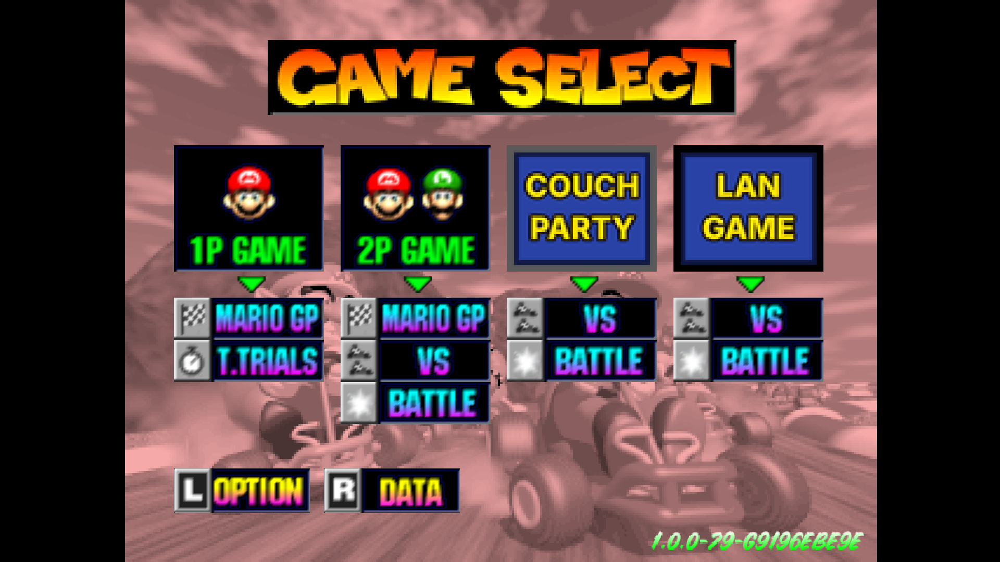
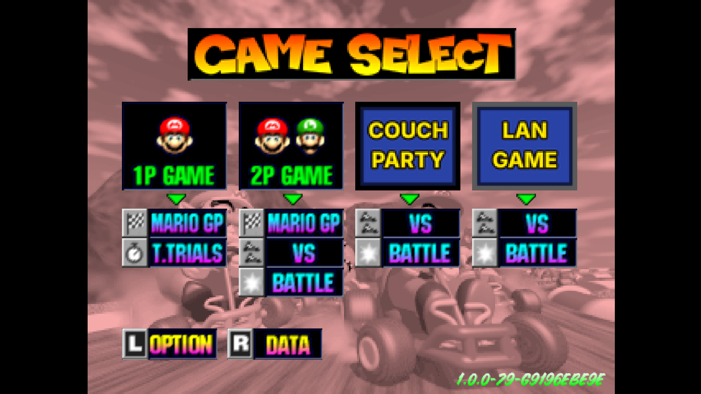
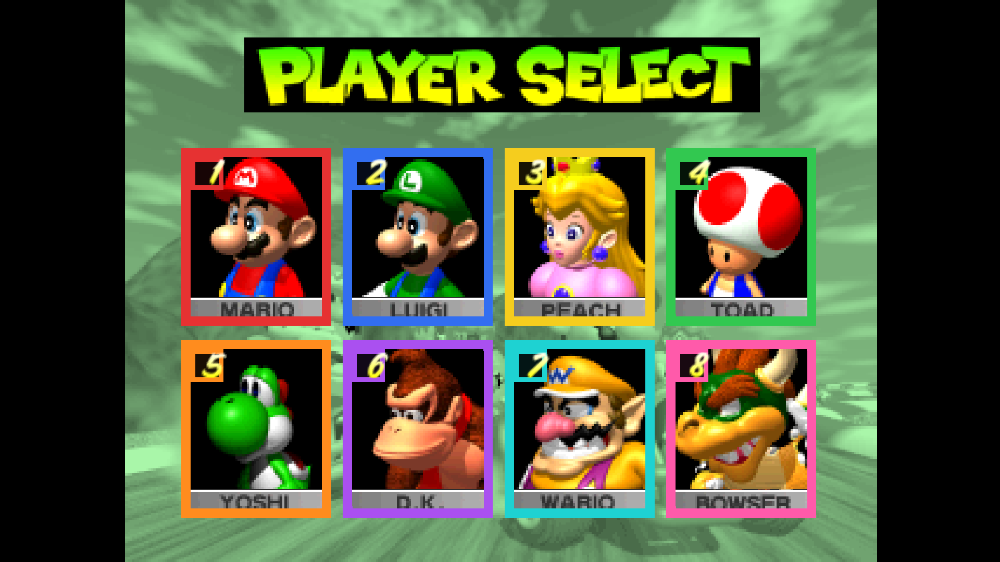
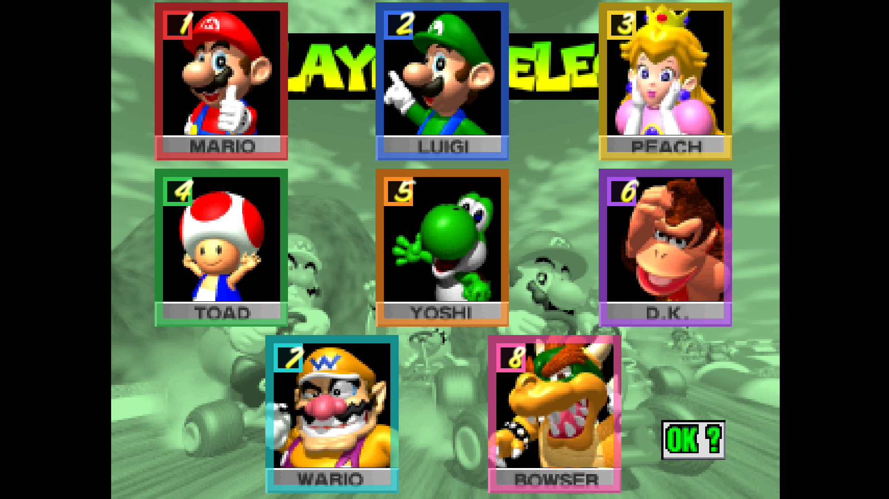
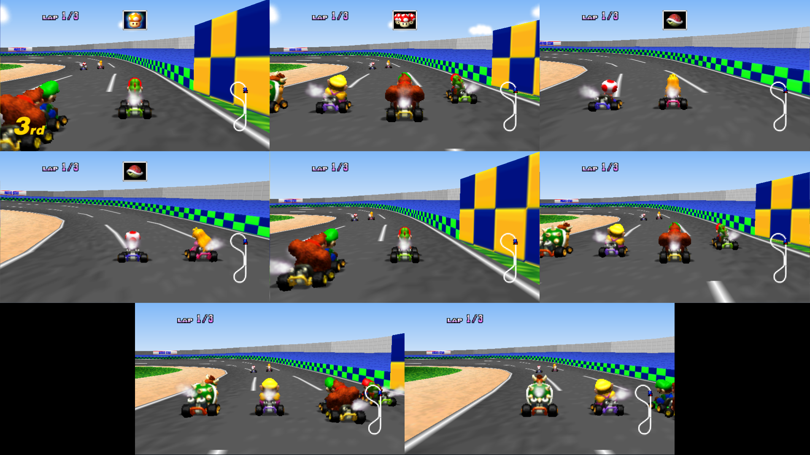
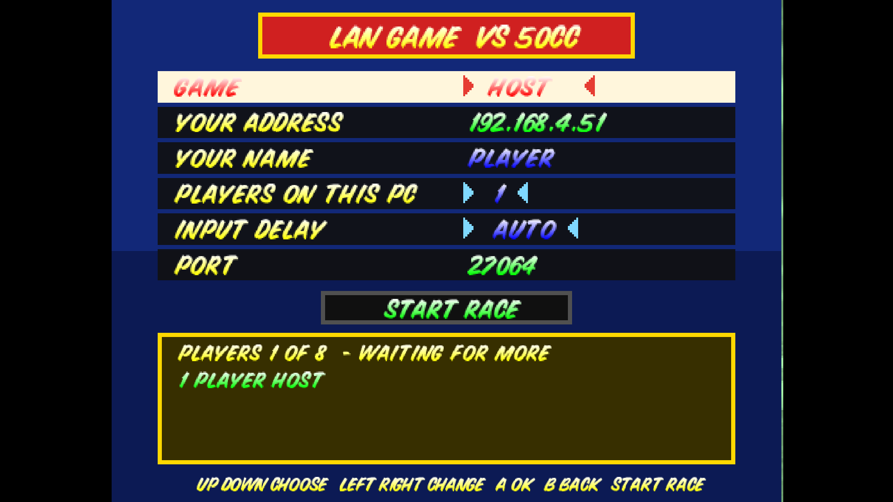
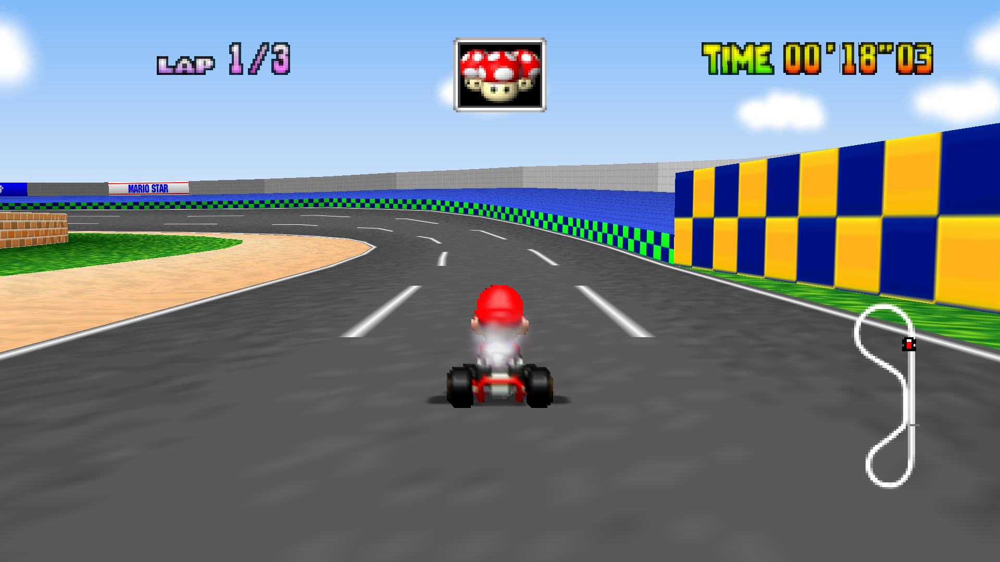
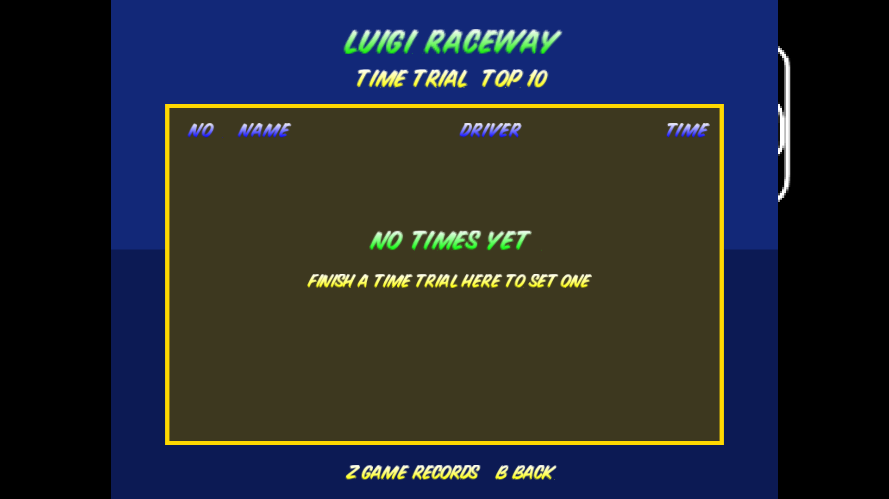
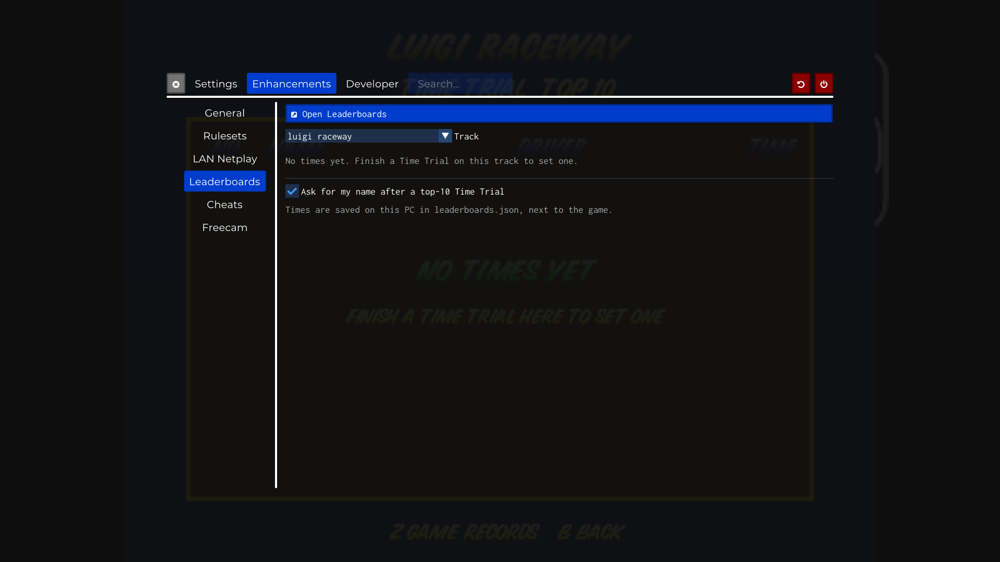
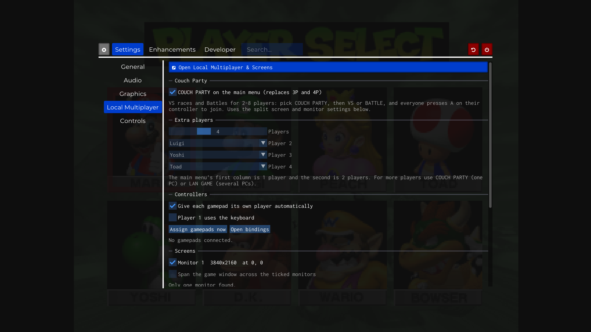

# SpaghettiKart: 8 Player with LAN

An unofficial build of [SpaghettiKart](https://github.com/HarbourMasters/SpaghettiKart) (the Mario Kart 64 PC port by HarbourMasters) that adds:

- **COUCH PARTY**: VS races and Battles for **up to 8 players on one PC**, each with their own split-screen view (and optional extra monitors).
- **LAN GAME**: VS and Battle for **up to 8 players across several PCs** on your local network, with up to 4 players per PC.
- **Time Trial leaderboards**: a top 10 per track, saved on your PC, with **each player's name** entered after a top-10 run.
- **Replaceable menu pictures** for the COUCH PARTY and LAN GAME buttons and the character-select frame.

> This project contains **no Nintendo game data**. You need your own Mario Kart 64 ROM (US version, `.z64`).

## Download

**[⬇ Download SpaghettiKart-LAN8-Setup.exe](https://github.com/T3chnobone/Spaghettikart-8-Player-with-Lan/raw/latest-build/SpaghettiKart-LAN8-Setup.exe)** · **HD textures:** [MK64 Reloaded (sk files)](https://github.com/GhostlyDark/MK64-Reloaded/releases/tag/v2026.04.03), see [HD textures](#hd-textures-optional) below.

The setup is small: when it runs it **downloads the newest build from this repo**, so the same setup always installs the latest version. To update later, run it again or use **Start menu > SpaghettiKart LAN8 > Check for updates**. You need an internet connection while it installs.

- Installs for your Windows account only (no admin prompt), by default to `%LOCALAPPDATA%\SpaghettiKart-LAN8`.
- Adds Start menu and desktop shortcuts and an uninstaller (Settings > Apps).
- Updating keeps your settings, leaderboards, mods and any menu pictures you replaced.

Windows may warn that the app is from an unknown publisher because the build isn't signed: choose **More info > Run anyway**.

### First run

1. Start **SpaghettiKart LAN8**. A file window opens: pick your Mario Kart 64 ROM (or copy the `.z64` into the game folder first).
2. Wait while it builds `mk64.o2r` from the ROM. **This can take up to 20 minutes** and the window says "Not responding" the whole time. Don't close it. After that the game starts straight away every time.
3. The game uses OpenGL. If you get a black screen, press **Esc** > Settings > Graphics > Renderer API > DirectX 11 and restart.

### HD textures (optional)

The game looks much sharper with the **MK64 Reloaded** HD texture pack by GhostlyDark.

1. Open the [MK64 Reloaded v2026.04.03 release](https://github.com/GhostlyDark/MK64-Reloaded/releases/tag/v2026.04.03).
2. Download **only a file with `sk` in its name** (those are the SpaghettiKart versions; the others are for other emulators):
   - [`mk64-reloaded-v2026.04.03-sk-hd.o2r`](https://github.com/GhostlyDark/MK64-Reloaded/releases/download/v2026.04.03/mk64-reloaded-v2026.04.03-sk-hd.o2r) (HD, 424 MB), or
   - [`mk64-reloaded-v2026.04.03-sk-4k.o2r`](https://github.com/GhostlyDark/MK64-Reloaded/releases/download/v2026.04.03/mk64-reloaded-v2026.04.03-sk-4k.o2r) (4K, 1.15 GB).
3. Put the `.o2r` file in the **`mods`** folder inside the game folder (by default `%LOCALAPPDATA%\SpaghettiKart-LAN8\mods`). Create the `mods` folder if it isn't there. Don't unzip or rename the file.
4. Restart the game.

## Screenshots

| | |
|---|---|
|  |  |
| Main menu: COUCH PARTY replaces 3P/4P | LAN GAME in the 4th column |
|  |  |
| Couch Party character select, 8 players joined | Everyone picked |
|  |  |
| 8-player split-screen race | LAN GAME setup (host) |
|  |  |
| Time Trial | TOP 10 board on the DATA screen |
|  |  |
| Enhancements > Leaderboards | Settings > Local Multiplayer |

## How to play

### Couch Party (one PC, 2-8 players)
1. On the main menu go right to **COUCH PARTY** and pick **VS** or **BATTLE**.
2. Player 1 is the controller that drove the menus. Everyone else presses **A** on their own controller to join (up to 8). Each gets a coloured numbered cursor.
3. Player 1 picks the course. Everyone gets their own view.
4. Split layout and extra monitors: **Esc** > Settings > Local Multiplayer.
5. After the race: Race again, Change course, Change drivers or Quit.

### LAN Game (2-8 players on several PCs)
Every PC needs this same build and the same ROM.
1. Main menu > **LAN GAME** > VS or BATTLE.
2. Choose **HOST** or **JOIN**, enter your name, and set how many players are on this PC (1-4).
3. Joiners pick the host from "games found on this network" (or type its address). The host presses **START** when everyone's in.
4. Allow the game through Windows Firewall when asked (UDP/TCP port **27064**).

### Time Trial leaderboards
Finish a Time Trial with a top-10 time and the game asks for your name (up to 7 letters). Boards are on the **DATA** screen (R on the main menu) and in **Esc** > Enhancements > Leaderboards. Times are saved in `leaderboards.json` in the game folder.

More detail is in the [docs](docs/) folder (also installed with the game).

## Publishing an update

The setup always installs whatever is on the [`latest-build`](../../tree/latest-build) branch, so **the setup itself never needs rebuilding**. To publish a new build:

1. Zip the Windows build folder (the folder with `Spaghettify.exe`, the DLLs, `spaghetti.o2r`, `yamls`, `docs`, `textures`...) as **`SpaghettiKart-LAN8-Windows.zip`**. No ROM and no `mk64.o2r`.
2. Replace the files on the `latest-build` branch with it and a new `version.txt` (one line, e.g. `2026-11-21 (main abc1234)`), keeping the branch to one commit:

```
git fetch origin latest-build && git switch latest-build
cp /path/to/SpaghettiKart-LAN8-Windows.zip .
printf "2026-11-21 (main abc1234)" > version.txt
git add -A && git commit --amend -m "Latest build: $(cat version.txt)"
git push -f origin latest-build
```

Everyone who runs the setup or **Check for updates** after that gets the new build.

### Building the setup

Only needed if `installer/installer.nsi` or `installer/get-latest.ps1` change. With [NSIS](https://nsis.sourceforge.io/) 3:

```
makensis installer/installer.nsi    # writes installer/SpaghettiKart-LAN8-Setup.exe
```

Then put the new `SpaghettiKart-LAN8-Setup.exe` on the `latest-build` branch too.

## Credits and licence

- SpaghettiKart by [HarbourMasters](https://github.com/HarbourMasters/SpaghettiKart); libultraship (MIT, see `LICENSE-libultraship.txt`).
- Mario Kart 64 is © Nintendo. This is a fan project and is not affiliated with or endorsed by Nintendo.
