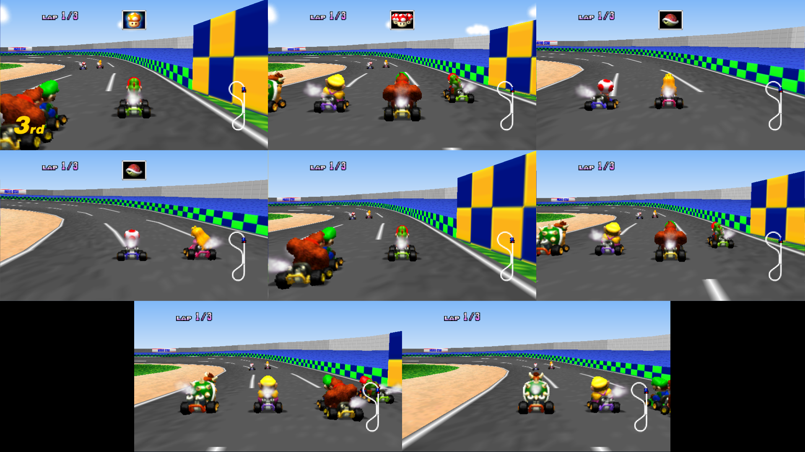
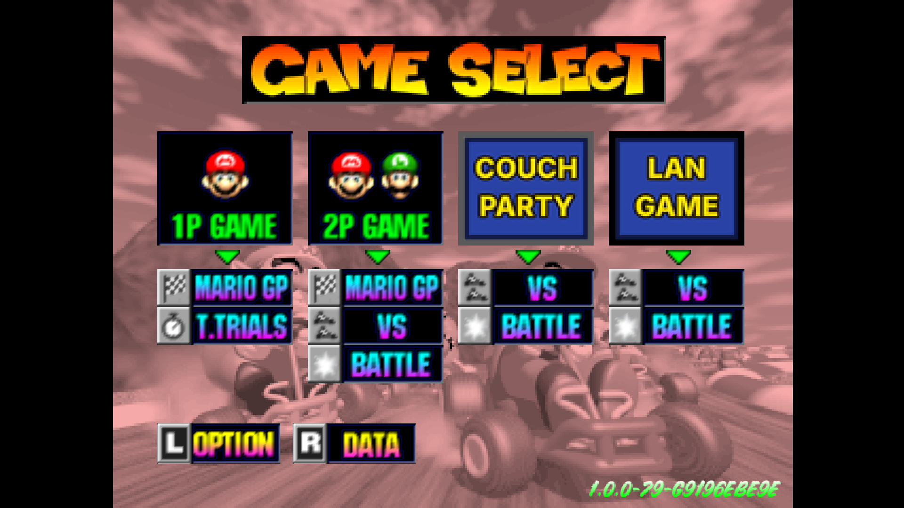
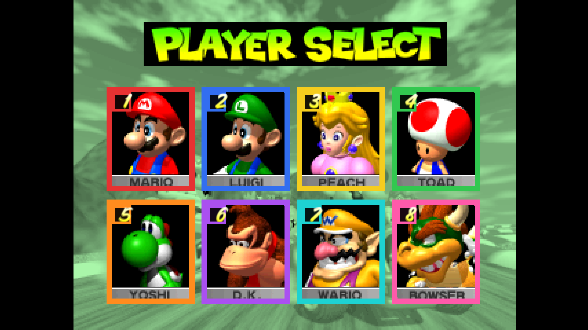
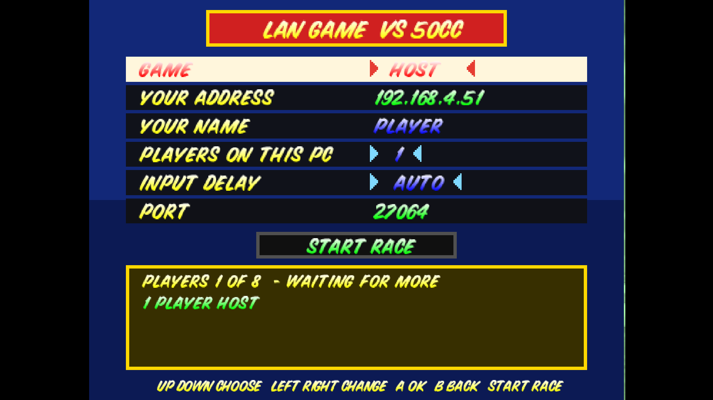
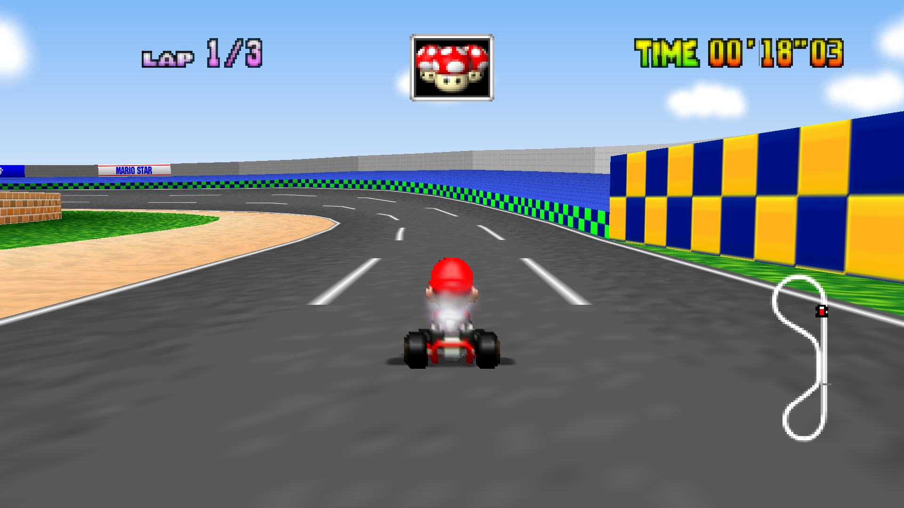
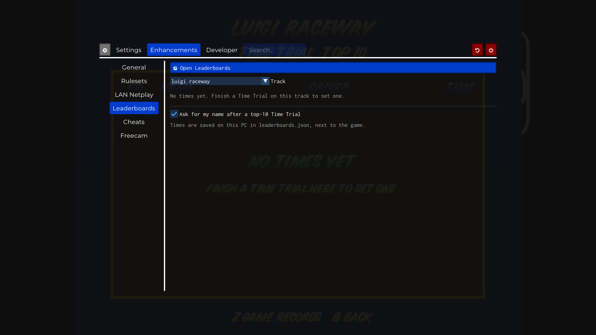

First public build of **SpaghettiKart: 8 Player with LAN**, an unofficial SpaghettiKart build with 8-player Couch Party split-screen, LAN netplay for up to 8 players, and Time Trial leaderboards with player names.

## Install
1. Download **SpaghettiKart-LAN8-Setup-0.1.0.exe** below and run it (no admin needed; Windows may say "unknown publisher": More info > Run anyway).
2. Start the game and pick your own Mario Kart 64 ROM (US, .z64). The first run builds `mk64.o2r` and **can take up to 20 minutes** with the window showing "Not responding". Leave it running.

Contains no Nintendo game data.

## What's in it
- **COUCH PARTY**: VS and Battle for 2-8 players on one PC, each with their own view.
- **LAN GAME**: VS and Battle for up to 8 players across PCs (port 27064).
- **Time Trial TOP 10** per track with player names.
- Replaceable COUCH PARTY / LAN GAME menu pictures.

## Screenshots

## Known issues
- Only player 1's view shows the race position; pause only dims the middle of the screen in 8-player races.
- On the main menu the highlighted column's tile overlaps its neighbour.
- Small drawing glitches on the DATA TOP 10 and LAN setup screens.
